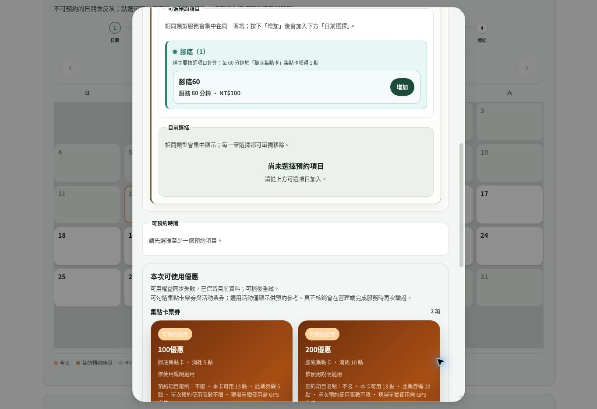

# 預約管理端與用戶端：程式、操作體驗與安全檢查

日期：2026-10-12（Asia/Taipei）。基準：main `0c4d294a10260410ff0f2c2805812da8e6a37194`。

## 核心判斷與證據範圍

FACT：主要身分、管理員權限、會員資格、預約擁有權與核銷規則已由後端處理。這次問題集中在「畫面上的版本、實際送出的內容、重試識別、操作結果回饋」不一致，以及兩张收據資料表的多餘權限。

本次依最新 repository、Supabase 實際 RPC 定義、資料表權限與安全 advisors 檢查核心預約流程，並以正式程式執行隔離 DOM / PostgreSQL 測試。未進行真實會員資料的攻擊或清空測試，也未將程式檢查視為整個專案不存在其他漏洞的保證。

## 流程與責任邊界

| 階段 | 用戶端／管理端程式 | 後端責任 |
| --- | --- | --- |
| 身分與連線 | `booking/common.js`、`admin/admin-session.js` | `_shared/auth-contract.ts` 驗證 LINE issuer、audience、到期時間、撤銷狀態與管理員資格；測試連線走獨立測試身分驗證 |
| 日期、項目與技師 | `booking/app.js`、`group-booking.js`、`contact-details.js` | `booking-api`、`booking-group-api`、`booking-group-slots-api` 檢查服務、數量、主要技師、人數與時段；價格與分鐘取自資料庫 |
| 建立／修改 | 表單確認、requestId 與完整草稿識別 | 交易 RPC 處理同一請求重試、版本、預約資源與票券保留；前端不直接寫入預約表 |
| 取消申請 | `app.js` → `member-ui.js` → `booking-cancellation-api` | 檢查會員擁有權、版本、可取消狀態及開始時間；取消待審核期間保留原時段 |
| 管理端處理 | `admin/booking-panel-core.js` | `booking-api`、`booking-admin-operations` 檢查 active admin、允許的狀態轉換及資料版本；完成走正式結算流程 |
| 快照與收據 | `booking-receipt.js`、`booking-accessible.js` | `booking-receipt-api` 驗證收據擁有權、檔案實際大小／magic MIME／hash、目前票券與點數規則，再由管理端審核 |

一般預約選券不要求 GPS；快照依管理端設定要求定位；快照不需要事先存在有效預約。此次保留這些既定差異。

## 已修正問題

| 問題與觸發操作 | 根因與影響 | 修正 |
| --- | --- | --- |
| 取消畫面上的舊預約 | `app.js` 只送 bookingId；`member-ui.js` 也丟掉 expectedUpdatedAt。兩個取消端點容許 null，資料庫原有的版本檢查因此未啟用 | 全路徑傳遞畫面版本，兩個端點拒絕缺失／無效版本。衝突或送出結果不明時回查，保留伺服器的擁有權與交易鎖 |
| 多人預約逾時後更換技師、受服務者或聯絡資料再試 | requestId 的內容識別只含第一位項目、日期、備註與票券，沒有涵蓋擴充模組真正送出的內容 | `BookingGroupUI.writeContext` 提供參與者、技師、服務對象與聯絡欄位；相同完整草稿沿用 requestId，變更內容建立新的識別。聯絡資料單獨模式亦提供識別內容 |
| 使用者選好技師後收到背景同步 | 每次 group bootstrap 都重新初始化第一位技師，可能在使用者未察覺時變更服務安排 | 只在首次 bootstrap 初始化，後續保留仍開放的技師，並配合目前人數上限收斂人數；停用的技師不可繼續選用 |
| 管理端確認／拒絕／取消後看不到錯誤 | 操作結果寫入「服務項目」分頁的訊息，而人仍在「用戶預約」分頁；refreshAll 失敗也回傳成功 | 在一般預約工作區加入 aria-live 狀態欄，顯示進度、成功、失敗及「操作成功但同步失敗」；refreshAll 正確回傳 false |
| 管理端送出中再次點擊或改表單 | state.busy 防止部分寫入，但畫面仍可操作，沒有明確進度 | 寫入期間停用相關控制項、標記 aria-busy、完成後恢復原先停用狀態；拒絕／取消增加確認，完成保留原有結算預覽 |
| 用戶在歷史列表申請取消卻看不到結果 | 結果寫在藏於預約視窗中的 formMessage | 在「我的預約」加入獨立狀態訊息；取消按鈕顯示送出中並防止連點 |
| 網路斷線後誤判可以直接重送 | 聯絡資料寫入／取消傳輸層將結果不明視為一般網路錯誤 | 對寫入逾時、無法解析回應或連線中斷採 API_RESPONSE_UNCERTAIN，不自動重送；建立預約使用既有回查與相同識別重試流程 |

## 資安判斷與處置

FACT：`booking_receipts` 與 `booking_receipt_cleanup_queue` 啟用 RLS 且沒有 public policies，但 `anon`、`authenticated` 原本仍有 ALL table privileges，包含 TRUNCATE。PostgreSQL 的 TRUNCATE 不受逐列 RLS 管理，因此沒有必要保留這些權限。

校準：這是權限過大與防禦邊界缺口；未找到本次公開 HTTP API 可直接執行 TRUNCATE 的路徑，不宣稱匿名使用者已能透過公開 API 清空所有收據。

已套用 `booking_receipt_least_privilege` migration，撤銷 PUBLIC、anon、authenticated 對上述兩表的全部權限，保留既有 service_role 後端流程。線上回查確認兩個 public 角色的 SELECT、INSERT、TRUNCATE 均為 false，service_role 保持 true；隔離 PostgreSQL 測試也實際驗證拒絕讀取／寫入／清空、後端仍可讀寫與清理，且 migration 可重複執行。

其他已查核的邊界：會員預約查詢限定本人；取消 RPC 以 bookingId 加 memberId 選取並鎖定資料；重要預約及結算 RPC 不開放 anon/authenticated；完成結算不能從一般狀態更新端點繞過；快照票券仍在審核／核銷時重新驗證，不能把前端勾選當作授權。

## 操作體驗的實際觀察



此圖來自本次即時頁面，沒有聯絡資料。截圖時背景同步顯示失敗；不以仍可看到舊票券資料推定當下可成功核銷。

| 步驟 | 一般健康狀態 | 證據與限制 |
| --- | --- | --- |
| 1. 選擇測試會員 | 可完成 | 即時頁面提供虛擬測試帳號並成功登入；沒有輸入真實會員憑證 |
| 2. 選擇日期 | 可完成 | 禁用日期提供理由，開放日期能開啟預約視窗 |
| 3. 選擇服務對象、技師、聯絡資料 | 可進入、資訊較多 | 目前表單依服務對象、聯絡資料、逐位服務、時段與票券排列；已保存本次實際畫面。沒有在此即時頁面提交新預約 |
| 4. 建立／修改／取消與管理端處理 | 已做程式及隔離操作驗證 | 真正管理端需要 LINE 登入，沒有可用管理員 browser session。DOM 測試使用正式 handlers 和隔離傳輸；不等同真人 LINE 或 Chromium 的完整驗證 |
| 5. 快照定位與結算 | 已做相關回歸 | GPS、收據、票券與結算採用既有隔離測試，未重新操作真實會員定位或發送通知 |

鍵盤焦點與對話框測試仍會執行；狀態訊息加入 live region，但沒有宣稱已通過完整 WCAG 或真實螢幕閱讀器認證。

## 部署、相容性與回復

資料庫權限收斂已在線上完成。其餘前端／Edge Function 修改以同一 PR 提交。`expectedUpdatedAt` 成為取消端點的必要欄位；舊快取頁面若未帶版本，會收到「更新預約紀錄後再取消」，不會修改資料。前端資產版本已更新，QA 呼叫與跨會員拒絕測試也帶入版本。部署時先更新前端，再部署 booking-api、booking-cancellation-api 及 user-test-api。

這次沒有刪除會員、收據或預約資料，沒有新增套件，也沒有變更表結構。應回復程式版本以處理 UI 回歸；不要為回復而重新授予 public 角色 TRUNCATE。若需要新增直接資料存取，應明確評估讀取／寫入需求並建立對應授權。

## 仍需注意的操作風險

RECOMMENDATION：GPS 座標、收據照片與聯絡資料由用戶端提供；定位規則與檔案驗證可限制格式和條件，不能證明真人在場或消費真實性。保留管理端人工核對，不應自動授予點數。

FACT：即時頁面目前開放測試帳號登入；這符合目前測試環境，未擅自關閉。正式營運前應確認測試模式是否仍適合開放。advisors 仍有 `pg_net` 位於 public schema 的既有 WARN，此次不移動擴充套件，以免影響通知排程；[官方修正指引](https://supabase.com/docs/guides/database/database-linter?lint=0014_extension_in_public)。RLS enabled / no policy 的 INFO 不代表必須開放 policies；後端專用表採預設拒絕 public 存取符合目前架構。

## 驗證紀錄

| 驗證 | 實際結果 |
| --- | --- |
| 全部 application regression | 774 / 774 通過 |
| 管理端正式 handlers 的隔離 DOM 操作 | 122 / 122 通過 |
| 預約啟動、票券、設定、收據／定位與結算相關整合 | 58 / 58 通過；涵蓋當時新增的 5 個操作完整性情境 |
| 最新操作完整性測試 | 6 / 6 通過（在上述 5 個情境外，追加聯絡資料模式斷線驗證） |
| 修改的 browser JavaScript syntax／diff whitespace | 通過 |
| Supabase 權限回查及 migration 後安全 advisors | 權限符合預期；仍有 1 個既有 pg_net schema WARN，無新增 ERROR |

測試集合有重疊，不將執行次數相加當作獨立案例總數。管理端操作證據是 DOM，不宣稱本次已跑 Chromium、真實 LINE 登入、訊息送達或真人 GPS。

可重現主要指令：

```bash
node --test --test-concurrency=2 MemberWebsocket-dev/tests/*.test.js
node --test MemberWebsocket-dev/tests/integration/booking_operation_integrity.cjs
node --max-old-space-size=1024 --test MemberWebsocket-dev/tests/integration/admin_human_journeys.cjs
```

`booking_operation_integrity.cjs` 已加入 GitHub Actions 整合測試工作，管理端原有流程也追加目前分頁成功訊息驗證。
